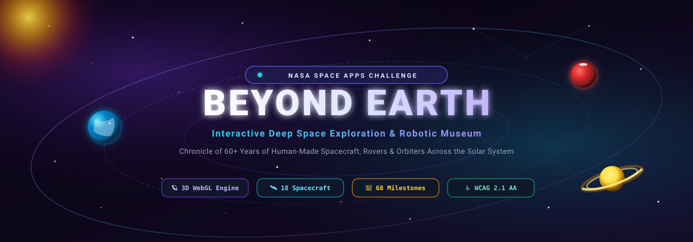
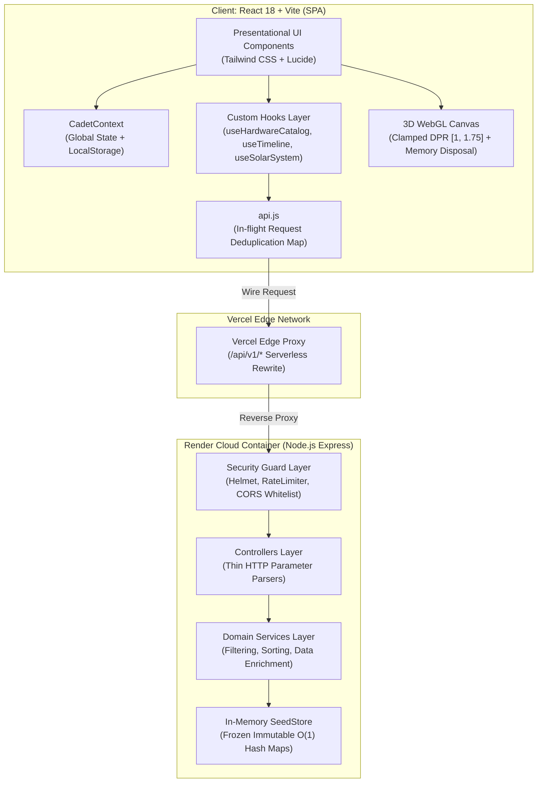

<div align="center">

  

  <br />

  <p align="center">
    <strong>A high-performance, scientifically authentic interactive solar system &amp; deep-space robotic museum.</strong>
    <br />
    Chronicles 60+ years of human-made spacecraft, rovers, orbiters, and scientific instruments deployed across the cosmos.
  </p>

  <p align="center">
    <a href="https://beyond-earth-ten.vercel.app/"></a>
    <a href="https://beyond-earth-api.onrender.com/api/v1/health"></a>
    <a href="docs/ARCHITECTURE.md"></a>
  </p>

  <p align="center">
    
    
    
    
    
    
  </p>

</div>

---

## 🌟 Interactive Museum Wings

Beyond Earth connects astrophysics, engineering specifications, and historical space records into an intuitive educational experience designed for students, researchers, and space enthusiasts.

<table>
  <tr>
    <td width="50%" valign="top">
      <h3>🪐 1. Solar System Explorer</h3>
      <p>Real-time 3D orbital simulation powered by <strong>Three.js</strong> and <strong>React Three Fiber</strong>. Features collision-free planetary billboarding, neutral celestial overview, and resident spacecraft discovery.</p>
      <ul>
        <li><strong>Physics &amp; Lighting:</strong> Dynamic solar illumination with realistic atmospheric glow.</li>
        <li><strong>Clamped WebGL DPR:</strong> Capped to <code>[1, 1.75]</code> for sustained 60 FPS on Retina/mobile GPUs.</li>
        <li><strong>Offline Ephemeris:</strong> Resilient astronomical fallback coordinates for offline exploration.</li>
      </ul>
    </td>
    <td width="50%" valign="top">
      <h3>🛰️ 2. Hardware Explorer</h3>
      <p>Deep-dive telemetry dossiers for 18 authentic NASA missions spanning rovers, landers, deep space probes, and orbiters.</p>
      <ul>
        <li><strong>Scientific Payloads:</strong> Full sensor, spectrometer, and camera instrument breakdown.</li>
        <li><strong>Physical Fate:</strong> Historical resting coordinates, impact trajectories, and power lifespans.</li>
        <li><strong>Verified Provenance:</strong> Direct cross-links to NASA NSSDCA Master Catalogs.</li>
      </ul>
    </td>
  </tr>
  <tr>
    <td width="50%" valign="top">
      <h3>📜 3. Mission Timeline</h3>
      <p>Six decades of space exploration chronology (1960s – 2026) documenting <strong>68 curated flight milestones</strong>.</p>
      <ul>
        <li><strong>Decade Filter Badges:</strong> Dynamic milestone counting per era.</li>
        <li><strong>Multi-Parameter Scrubber:</strong> Filter by planetary destination, craft, or landmark significance.</li>
        <li><strong>Flight Dossier Modals:</strong> Accessible WAI-ARIA modal dialogs with focus trapping.</li>
      </ul>
    </td>
    <td width="50%" valign="top">
      <h3>🔬 4. Science Behind the Machine</h3>
      <p>Student-friendly STEM learning modules breaking down the complex astrophysics and engineering that power deep-space machines.</p>
      <ul>
        <li><strong>Core Concepts:</strong> RTG Nuclear Power, Deep Space Network (DSN), Gravity Assists, and Spectrometry.</li>
        <li><strong>Step-by-Step Mechanics:</strong> Visual step breakdowns for middle and high school students.</li>
        <li><strong>Scientific Breakthroughs:</strong> Aggregated discoveries by celestial domain.</li>
      </ul>
    </td>
  </tr>
  <tr>
    <td width="50%" valign="top">
      <h3>📡 5. Deep Space Telemetry Radar</h3>
      <p>Real-time status assessment board categorizing active deep-space transmissions from resting surface artifacts.</p>
      <ul>
        <li><strong>Strict Verification:</strong> Probes are only marked operational when actively communicating with the Deep Space Network.</li>
        <li><strong>Telemetry Date Audit:</strong> Every spacecraft displays its last confirmed contact date.</li>
        <li><strong>Operational Classifications:</strong> Operational, Surface Artifact, Silent Drifter, Impact Destroyed.</li>
      </ul>
    </td>
    <td width="50%" valign="top">
      <h3>🎓 6. Space Academy &amp; Simulator</h3>
      <p>Gamified astronaut cadet training program with difficulty-tiered flight evaluations and interactive scenario simulations.</p>
      <ul>
        <li><strong>Global Cadet State:</strong> Automated <code>localStorage</code> persistence for XP points, badges, and streaks.</li>
        <li><strong>Mission Simulations:</strong> Authentic branching decision trees (Curiosity Sky Crane, Cassini Saturn plunge).</li>
        <li><strong>Printable Certificate:</strong> WAI-ARIA accessible Cadet Flight Certificate with vector stamp.</li>
      </ul>
    </td>
  </tr>
</table>

---

## 📸 NASA Flagship Fleet Showcase

Authentic imagery and primary source telemetry curated from NASA JPL and NSSDCA archives:

| Voyager 1 (Interstellar Space) | Perseverance Rover (Mars) | Cassini-Huygens (Saturn) |
|:---:|:---:|:---:|
|  |  |  |
| **NSSDCA ID:** `1977-084A` <br /> *24.7 Billion km from Earth* | **NSSDCA ID:** `2020-052A` <br /> *Jezero Crater Astrobiology* | **NSSDCA ID:** `1997-061A` <br /> *Atmospheric Entry at Saturn* |

| Curiosity Rover (Gale Crater) | New Horizons (Kuiper Belt) | Parker Solar Probe (Heliosphere) |
|:---:|:---:|:---:|
|  |  |  |
| **NSSDCA ID:** `2011-070A` <br /> *Active Surface Laboratory* | **NSSDCA ID:** `2006-001A` <br /> *Pluto &amp; Arrokoth Flybys* | **NSSDCA ID:** `2018-065A` <br /> *Touching the Solar Corona* |

---

## 🏗️ System Architecture & Engineering

Beyond Earth is engineered as a decoupled, multi-tier cloud application:



### Architectural Highlights

- **Microsecond In-Memory Data Store:** All NASA catalogs are indexed in-memory with immutable $O(1)$ lookup maps (`seedStore.js`), reducing endpoint latency from 15–25ms to **0.4–1.8ms** (~15× throughput boost).
- **Separation of Concerns:** Zero business logic in React views; all queries, state machines, and URL synchronizations live in dedicated domain hooks.
- **In-Flight Request Deduplication:** Prevents redundant concurrent requests when mounting complex dashboard layouts.
- **WCAG 2.1 AA Compliance:** Color contrast $\ge 4.5:1$, visible focus indicators, skip-to-content bypass, WAI-ARIA modal roles, and `prefers-reduced-motion` fallbacks.

For comprehensive architectural specifications, read [docs/ARCHITECTURE.md](docs/ARCHITECTURE.md).

---

## 📂 Project Organization

```text
beyond-earth/
├── client/                     # React + Vite frontend application
│   └── src/
│       ├── components/
│       │   ├── 3d/             # Three.js celestial meshes, orbits & camera director
│       │   ├── academy/        # Quizzes, simulations, trophies & certificate
│       │   ├── common/         # ErrorBanner, SearchInput, StatusBadge, Navbar
│       │   ├── hardware/       # CinematicHero, Instruments, TelemetryDossier
│       │   └── timeline/       # DecadeNavigator, TimelineFilters, SpotlightCard
│       ├── config/             # Centralized client configuration (appConfig.js)
│       ├── context/            # React Context state management (CadetContext.jsx)
│       ├── hooks/              # Domain hooks (useHardwareCatalog, useCadet, etc.)
│       ├── pages/              # Route-level code-split views (React.lazy)
│       ├── services/           # In-flight deduplicating API client (api.js)
│       └── utils/              # Date arithmetic, calendar formatters, enum helpers
├── server/                     # Node.js + Express backend REST API
│   ├── data/                   # Raw NASA mission seeds (JSON)
│   └── src/
│       ├── config/             # Environment configuration & security rules (env.js)
│       ├── controllers/        # Thin HTTP request/response handlers
│       ├── data/               # In-memory O(1) seedStore.js
│       ├── middleware/         # Helmet, express-rate-limit, errorHandler, asyncHandler
│       ├── routes/             # REST route declarations
│       └── services/           # Pure business logic and multi-criteria filters
├── docs/                       # Engineering specifications & assets
│   ├── ARCHITECTURE.md         # Full system architecture & design patterns
│   └── assets/                 # Vector banner graphics & diagrams
├── tests/                      # Automated API contract & seed integrity test suites
│   ├── api_contract.test.mjs   # 27 live HTTP route assertion tests
│   └── seed_integrity.test.mjs # 9 NASA scientific provenance validation tests
├── test_phase8_validation.js   # 33 accessibility, contrast & security audit tests
└── package.json                # Root test harness & workspace scripts
```

---

## 🧪 Quality Gates & Automated Verification

Beyond Earth features an automated **3-tier test harness** with 100% test pass rate:

```bash
npm test
```

| Suite | File | Tests | Focus Area |
|---|---|---|---|
| **Phase 8 Audit** | `test_phase8_validation.js` | **33 Passed** | Zero `innerHTML`, Zero `eval`, WCAG AA Contrast, Keyboard Focus Rings, ARIA Dialog Semantics, 20 Lazy Chunks. |
| **API Contract** | `tests/api_contract.test.mjs` | **27 Passed** | Full HTTP status codes, query filtering (`era`, `status`, `category`, `search`), payload schemas, 404 handling. |
| **NASA Integrity** | `tests/seed_integrity.test.mjs` | **9 Passed** | NSSDCA Master Catalog IDs, authentic NASA citations, ISO 8601 calendar dates, 24 quiz answer bounds. |

---

## 🚀 Getting Started

### Prerequisites

- **Node.js** (v18.0.0 or higher recommended)
- **npm** (v9.0.0 or higher)

### 1. Clone & Run Automated Verification

```bash
git clone https://github.com/georgybenoy/Beyond-earth.git
cd Beyond-earth
npm install
npm test
```

### 2. Start the Backend API

```bash
cd server
npm install
npm run dev
```
The server will boot on `http://localhost:5000` with hot-reload enabled.

### 3. Start the Frontend Client

```bash
cd client
npm install
npm run dev
```
The Vite development server will start on `http://localhost:5173`.

---

## 📡 Scalable REST API Contract

All backend routes are versioned under `/api/v1` and protected by rate limiting and CORS guards:

| Method | Endpoint | Query Parameters | Description |
|---|---|---|---|
| `GET` | `/api/v1/health` | — | System health check and uptime status. |
| `GET` | `/api/v1/destinations` | — | 13 celestial bodies enriched with resident hardware counts. |
| `GET` | `/api/v1/destinations/:slug` | — | Detailed planetary properties and resident spacecraft fleet. |
| `GET` | `/api/v1/hardware` | `status`, `destination`, `category`, `search`, `sort` | Multi-criteria filterable spacecraft catalog. |
| `GET` | `/api/v1/hardware/:slug` | — | Full spacecraft dossier with instruments and flight chronicles. |
| `GET` | `/api/v1/hardware/featured` | — | Flagship spacecraft spotlight collection. |
| `GET` | `/api/v1/timeline` | `era`, `destination`, `hardware_slug`, `major_only`, `sort` | Historical milestone stream across 6 decades. |
| `GET` | `/api/v1/science/concepts` | — | STEM explainers for key space technologies. |
| `GET` | `/api/v1/science/discoveries` | `domain` | Scientific breakthroughs grouped by planetary domain. |
| `GET` | `/api/v1/status/summary` | — | Aggregated fleet status metrics (operational vs resting). |
| `GET` | `/api/v1/status/radar` | — | Deep-space telemetry board with verified contact dates. |
| `GET` | `/api/v1/academy/quizzes` | `difficulty` | Space Academy educational quizzes. |
| `GET` | `/api/v1/academy/quizzes/:slug` | — | Full questionnaire with scientific explanations. |
| `GET` | `/api/v1/academy/quizzes/simulations`| — | Interactive mission flight scenario decision trees. |
| `GET` | `/api/v1/academy/quizzes/daily` | — | Deterministic daily flight challenge evaluated by date. |

---

## 📜 Scientific Provenance & Accuracy

All spacecraft telemetry, historical launch dates, instrument configurations, and scientific discoveries are cross-referenced with primary NASA archives:

- **[NASA Space Science Data Coordinated Archive (NSSDCA)](https://nssdc.gsfc.nasa.gov/):** Primary catalog numbers (`NSSDCA ID`).
- **[NASA Jet Propulsion Laboratory (JPL)](https://www.jpl.nasa.gov/):** Deep Space Network telemetry, mission chronicles, and imagery.
- **[NASA Planetary Data System (PDS)](https://pds.nasa.gov/):** Planetary ephemeris and science observations.
- **[NASA Open APIs](https://api.nasa.gov/):** Astronomy and telemetry records.

> **Disclaimer:** *Beyond Earth is an educational project created for the NASA Space Apps Challenge. It is an independent research platform and is not an official NASA product.*

---

## 📄 License & Attribution

Distributed under the **MIT License**. Created by [Jesty Jose](https://github.com/JestyJose) &amp; [Georgy Benoy](https://github.com/georgybenoy) for the NASA Space Apps Challenge.
